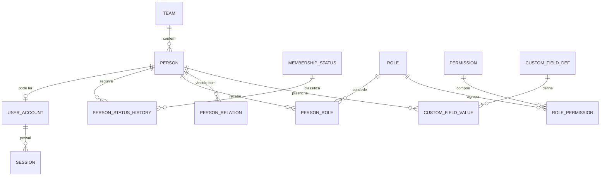
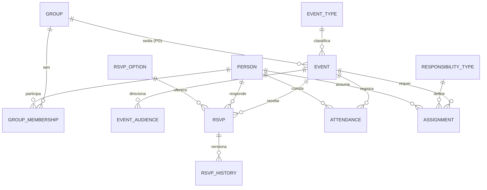
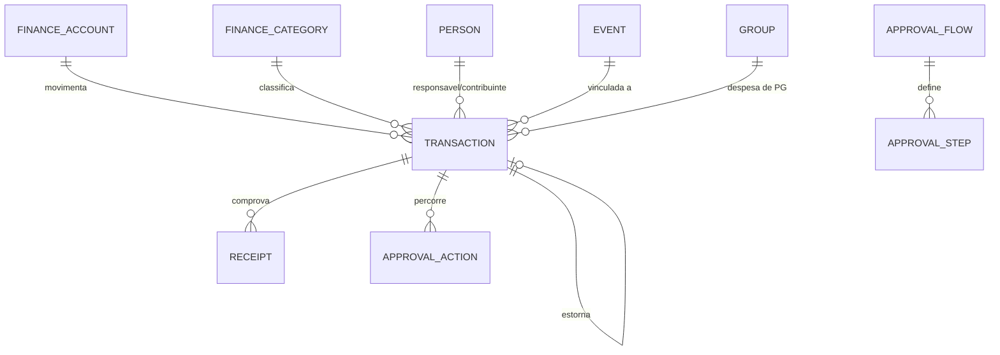
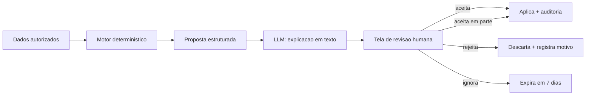

# Eagles App — Documento de Descoberta e Arquitetura Inicial

**Versão:** 0.2
**Data:** 18/08/2026
**Status:** **arquitetura aprovada** em 18/08/2026 — decisões D-01 a D-04 confirmadas pelo usuário e registradas em [`adr/`](adr/). D-05 a D-07 continuam pendentes (não bloqueiam o M01 local).

| Decisão                   | Escolha aprovada                                                                                                                   |
| ------------------------- | ---------------------------------------------------------------------------------------------------------------------------------- |
| **D-01** Stack            | SvelteKit 2 + TypeScript + PostgreSQL 16 + Drizzle                                                                                 |
| **D-02** MVP              | 6 módulos, ~10 semanas — sem financeiro (V1.2) e sem IA (V2.0)                                                                     |
| **D-03** Menores de idade | **Não há menores hoje; piso de 16 anos daqui em diante.** 16–17 ainda são menores na LGPD, então a estrutura fica pronta e inativa |
| **D-04** Acesso           | Convite por link do WhatsApp + senha definida pela pessoa                                                                          |

> ⚠️ **D-03 alterou a arquitetura descrita neste documento.** O impacto está detalhado na seção 12.6 e em [`adr/0003-dados-de-menores.md`](adr/0003-dados-de-menores.md).

**Convenção de origem da informação, usada em todo o documento:**

| Marca   | Significado                                                        |
| ------- | ------------------------------------------------------------------ |
| `[REQ]` | Requisito confirmado por você no briefing                          |
| `[DEC]` | Decisão técnica que tomei, com justificativa registrada            |
| `[SUG]` | Sugestão minha, aberta a rejeição                                  |
| `[HIP]` | Hipótese assumida por falta de informação — precisa ser confirmada |
| `[FUT]` | Funcionalidade futura, fora do escopo atual                        |

---

## 1. Resumo executivo do Eagles App

O Eagles App é uma **plataforma interna de gestão de comunidade**, usada durante todo o ano pelos Eagles para organizar pessoas, grupos (PGs), encontros, responsabilidades, participação e recursos financeiros — sem substituir a convivência humana que define o grupo. `[REQ]`

O produto **não é** um app de evento. O Outside é apenas um entre vários compromissos do calendário; o app registra a participação dos Eagles nele, mas não organiza o evento. `[REQ]`

Três características definem o produto e devem guiar todas as decisões:

1. **É ferramenta de apoio à liderança, não substituta dela.** Toda automação relevante — divisão de grupos, escalas, análise de frequência — termina em decisão humana explícita. O padrão arquitetural obrigatório é _sugerir → revisar → confirmar → aplicar_. `[REQ]`
2. **Convive com o WhatsApp, não compete com ele.** A conversa cotidiana continua lá. O app produz a informação organizada (escala, lembrete, prestação de contas) e facilita levá-la para o WhatsApp. `[REQ]`
3. **É configurável por natureza.** Tipos de evento, responsabilidades, campos de cadastro, categorias financeiras, papéis, permissões e funcionalidades inteiras (check-in, aprovação de despesas) são **dados no banco, não código**. `[REQ]`

**Recomendação central de arquitetura:** monólito modular full-stack em **SvelteKit (TypeScript) + PostgreSQL**, entregue como **PWA instalável mobile-first**, hospedado na VPS existente via Docker Compose com Caddy (HTTPS automático). Custo operacional adicional estimado: **R$ 40–90/mês** (domínio + IA sob demanda). Alternativas comparadas na seção 14. `[DEC]`

**Recomendação central de escopo:** MVP de **6 módulos em ~10 semanas** — Fundação, Pessoas, RBAC, Grupos, Eventos e Presença — com IA e Financeiro deliberadamente **depois**, pelas razões da seção 19. `[SUG]`

---

## 2. Entendimento do problema

### 2.1 O que os Eagles já fazem hoje

A comunidade já funciona: existe liderança, existem conselheiros, existem PGs com responsabilidades semanais, existem eventos, existe dinheiro entrando e saindo, existem visitantes virando membros. Nada disso depende do app — e é justamente por isso que o app precisa se encaixar no que já existe, não redesenhar a comunidade.

O que provavelmente acontece hoje `[HIP]` — e que o app precisa resolver:

| Dor                             | Sintoma típico                                                                                           | Onde o app entra                             |
| ------------------------------- | -------------------------------------------------------------------------------------------------------- | -------------------------------------------- |
| Informação dispersa             | Escala num grupo de WhatsApp, presença num caderno, dinheiro numa planilha, cadastro na cabeça de alguém | Fonte única de verdade consultável           |
| Memória organizacional frágil   | "Quem já pregou este mês?", "Fulano ainda vem?", "Quanto sobrou do último evento?"                       | Histórico persistente e pesquisável          |
| Divisão de grupos é trabalhosa  | Reorganizar PGs exige cruzar frequência, idade, vínculos, casais, irmãos — no papel ou na planilha       | Apoio à decisão, nunca decisão automática    |
| Prestação de contas informal    | Confiança pessoal substitui rastreabilidade; difícil responder "para onde foi o dinheiro?"               | Livro-caixa auditável com relatórios prontos |
| Pessoas somem sem ninguém notar | Visitante veio 3 vezes e parou; ninguém percebeu a tempo                                                 | Indicadores de frequência e sinal de atenção |
| Retrabalho de comunicação       | Reescrever o mesmo aviso em vários grupos                                                                | Geração e compartilhamento de mensagens      |

### 2.2 O que o app **não** deve resolver

- Não organiza o Outside — isso é de outra estrutura. `[REQ]`
- Não decide a qual equipe (Bears, Tigers, Sheeps) uma pessoa pertencerá. `[REQ]`
- Não substitui o WhatsApp como canal de conversa. `[REQ]`
- Não controla nem restringe a participação de ninguém em PG — check-in é apoio opcional, nunca porteiro. `[REQ]`
- Não é ERP nem sistema contábil. O financeiro é livro-caixa transparente, não contabilidade formal. `[REQ]`

### 2.3 O risco número um do produto

**Adoção.** O WhatsApp já resolve boa parte da comunicação com zero atrito. Qualquer funcionalidade que exija esforço adicional sem devolver valor imediato será abandonada em semanas — e um app abandonado deixa a organização **pior** do que estava, porque passam a existir duas fontes de verdade divergentes.

Consequência arquitetural que assumo como regra: **cada tela precisa ser justificável em uma frase para quem vai usá-la.** Se um membro não consegue responder "por que eu abriria isso?", a tela não entra no MVP. `[DEC]`

### 2.4 O risco número dois

**Burocratização.** O briefing é explícito: o app não pode transformar os Eagles num sistema engessado. Isso não é só cultura — tem consequência de design. Toda funcionalidade de controle (check-in, aprovação de despesas, campos obrigatórios, escalas rígidas) nasce **desligada**, e ligá-la é uma decisão consciente da liderança. `[REQ]` `[DEC]`

---

## 3. Objetivos do produto

### 3.1 Objetivos primários

1. Centralizar o cadastro de pessoas e sua jornada (visitante → recorrente → membro), com histórico preservado.
2. Organizar grupos/PGs com apoio à decisão nas reorganizações periódicas.
3. Gerir o calendário de eventos e reuniões com confirmação de presença real.
4. Registrar responsabilidades e escalas dos PGs sem repetição injusta.
5. Dar transparência financeira com prestação de contas simples e rastreável.
6. Reduzir trabalho manual repetitivo da liderança (relatórios, escalas, avisos).
7. Ajudar líderes a **enxergar pessoas** — quem está se afastando, quem está sobrecarregado, quem está pronto para mais.

### 3.2 Objetivos secundários

8. Preservar memória organizacional entre gestões.
9. Fornecer indicadores confiáveis para decisão.
10. Permitir que a organização evolua o sistema sem depender de desenvolvedor para tudo — configuração no lugar de código.

### 3.3 Não-objetivos explícitos

Substituir interação humana; burocratizar os PGs; automatizar decisões organizacionais; impressionar visualmente às custas da simplicidade.

---

## 4. Usuários e personas

Cinco personas, do maior para o menor volume de uso. As descrições comportamentais são `[HIP]` derivadas do briefing e precisam de validação sua.

### P1 — Membro Eagles — _"o uso diário"_

**Volume:** maioria dos usuários. **Frequência:** 1–3×/semana, sempre no celular, muitas vezes com internet ruim.
**Precisa:** ver o próximo encontro, confirmar presença em 1 toque, saber se está escalado, ver seu grupo, ver quanto contribuiu.
**Não tolera:** login complicado, mais de 3 toques para confirmar presença, excesso de notificação.
**Métrica de sucesso:** taxa de RSVP respondido sem cobrança manual.

### P2 — Visitante / Participante recorrente — _"a porta de entrada"_

**Volume:** rotativo. **Frequência:** esporádica.
**Precisa:** entender o que é, ver o próximo PG, se inscrever com o mínimo de dados.
**Não tolera:** cadastro longo, dados sensíveis no primeiro contato, sensação de estar sendo fichado.
**Métrica de sucesso:** % de visitantes que retornam e viram recorrentes.

### P3 — Conselheiro — _"o operador do sistema"_

**Volume:** poucos, mas são os usuários mais intensos — o sucesso do produto depende deles. **Frequência:** semanal, tarefas de 10–20 min.
**Precisa:** acompanhar o próprio grupo, ver quem está faltando, montar/ajustar escala, lançar despesa do PG, mandar aviso.
**Não tolera:** preencher formulário para o que resolveria numa mensagem.
**Métrica de sucesso:** tempo para montar a escala semanal; queda no "quem vai fazer o quê?" do grupo.

### P4 — Líder — _"a visão geral"_

**Volume:** 1–5 pessoas. **Frequência:** semanal, com picos em planejamento.
**Precisa:** panorama de tudo, indicadores, saúde dos grupos, situação do caixa, pendências, apoio para reorganizar grupos.
**Não tolera:** dado que não fecha; relatório em que não confia.
**Métrica de sucesso:** decisões tomadas com dado em vez de impressão.

### P5 — Administrador do sistema

Provavelmente a mesma pessoa do P4. **Precisa:** configurar tipos, papéis, permissões, chaves de funcionalidade, auditoria, backup.

### Persona negativa — _"o fiscal"_

Alguém que usaria frequência e check-in para cobrar, ranquear ou constranger membros. **O produto deve tornar esse uso desconfortável por design:** sem ranking público de presença, sem exposição de faltas entre pares, dados de frequência visíveis apenas a quem tem responsabilidade pastoral sobre a pessoa. `[DEC]`

---

## 5. Estrutura organizacional

### 5.1 Hierarquia confirmada `[REQ]`

```
Liderança
  └── Conselheiros
        └── Grupos / PGs
              └── Membros
                    └── Visitantes
```

### 5.2 Leitura arquitetural dessa estrutura

Um ponto central do briefing: **grupos não são níveis hierárquicos, são divisões organizacionais** — todos os membros de um grupo têm essencialmente a mesma permissão. `[REQ]`

Isso significa que a estrutura real do sistema tem **dois eixos independentes**:

| Eixo                      | O que representa                                       | Valores                               |
| ------------------------- | ------------------------------------------------------ | ------------------------------------- |
| **Autoridade** (papel)    | O que a pessoa pode fazer                              | Líder, Conselheiro, Membro, Visitante |
| **Pertencimento** (grupo) | Onde a pessoa está e sobre o que sua autoridade incide | PG Azul, PG Verde, …                  |

Um conselheiro tem autoridade **escopada** a um ou mais grupos. Um líder tem autoridade **global**. Um membro tem autoridade sobre si mesmo e leitura do próprio grupo.

**Consequência:** permissões precisam de **escopo** (`global` ou `grupo:X`), não apenas de papel. Esta é a decisão de modelagem mais importante de todo o sistema, e está detalhada na seção 11. `[DEC]`

### 5.3 Regras estruturais confirmadas `[REQ]`

- Um membro pertence a **no máximo um grupo por vez**.
- Grupos podem ser reorganizados ao longo do ano — o histórico de quem esteve onde é preservado.
- Apenas líderes e conselheiros criam, editam, excluem grupos e transferem membros.
- O contexto maior tem outras equipes (Bears, Tigers, Sheeps), **fora do escopo do app** — mas cuja existência deve caber no modelo como histórico de saída/transferência.

### 5.4 Decisão sobre multi-equipe `[DEC]`

Vou incluir uma coluna `team_id` nas tabelas principais desde o primeiro dia, com um único registro ("Eagles") preenchido, sem nenhuma interface de multi-equipe.

**Justificativa:** adicionar a coluna agora custa quase nada — uma FK e um filtro padrão na camada de repositório. Adicioná-la depois, com dados em produção, é uma migração de risco alto que atinge todas as consultas e todas as regras de permissão. O briefing menciona Bears, Tigers e Sheeps explicitamente; a probabilidade de "e se o app servisse as outras equipes também?" aparecer no ano 2 é alta.

**Custo se eu estiver errado:** uma coluna inútil. **Custo se eu não fizer e for necessário:** semanas de refatoração perigosa em código que mexe com dinheiro e permissão.

---

## 6. Regras de negócio identificadas

Numeradas para rastreabilidade — `RN-xx` será referenciado em testes e critérios de aceitação de cada módulo.

### Pessoas e jornada

- **RN-01** — Uma pessoa existe no sistema independentemente de ter conta de acesso. Cadastro de visitante feito por terceiros é válido. `[REQ]`
- **RN-02** — A jornada padrão é Visitante → Participante recorrente/pré-membro → Membro Eagles. Novos estágios devem poder ser criados sem alteração de código. `[REQ]`
- **RN-03** — Participar do Outside **não** promove ninguém a membro automaticamente. `[REQ]`
- **RN-04** — Toda mudança de status é registrada com data, autor e motivo opcional; o histórico é imutável. `[DEC]`
- **RN-05** — Campos obrigatórios do cadastro são configuráveis por administradores; apenas "nome" é obrigatório em nível de sistema. `[REQ]` `[DEC]`

### Grupos

- **RN-06** — Uma pessoa pertence a no máximo um grupo por vez — restrição garantida no banco, não só na aplicação. `[REQ]`
- **RN-07** — Transferência entre grupos encerra o vínculo anterior com data de saída e cria um novo; nada é sobrescrito. `[DEC]`
- **RN-08** — Só altera composição quem tem `group.manage` global, ou `group.manage` no escopo daquele grupo. `[REQ]`
- **RN-09** — Sugestões de reorganização **nunca** alteram grupos: produzem uma proposta que exige confirmação humana e pode ser aceita parcialmente. `[REQ]`

### Eventos e presença

- **RN-10** — Tipos de evento são dados configuráveis, não enum de código. `[REQ]`
- **RN-11** — As opções de RSVP são configuráveis por tipo de evento (confirmado, talvez, não vou, chegarei atrasado, levarei convidado, personalizadas). `[REQ]`
- **RN-12** — Toda resposta de RSVP é versionada: mudar a resposta preserva a anterior com timestamp. `[REQ]`
- **RN-13** — Presença efetiva é registro **distinto** do RSVP. A diferença entre os dois é um indicador de primeira classe. `[REQ]`
- **RN-14** — Check-in (incluindo QR Code) é opcional, ligável/desligável nas configurações gerais, e **nunca** condiciona a entrada de ninguém. `[REQ]`
- **RN-15** — Ausência de resposta de RSVP **não é falta** e não pode ser tratada como tal em nenhum relatório. `[DEC]`

### Responsabilidades

- **RN-16** — Tipos de responsabilidade são configuráveis. As categorias do briefing (palestra, mensagem, música, alimentação, organização, recepção) são **valores iniciais**, não o esquema. `[REQ]`
- **RN-17** — Escala pode ser criada manualmente, atribuída manualmente ou gerada automaticamente — as três formas coexistem. `[REQ]`
- **RN-18** — Escala gerada automaticamente entra como **proposta**; só vira oficial após confirmação humana. `[REQ]`
- **RN-19** — A geração evita repetição excessiva e respeita regras definidas pelos líderes. `[REQ]`

### Financeiro

- **RN-20** — Toda movimentação tem tipo (entrada/saída), categoria, valor, data, responsável, método de pagamento e descrição. Evento, grupo, comprovante e status são opcionais. `[REQ]`
- **RN-21** — Movimentação lançada **não é editada nem excluída fisicamente**: correção gera estorno + novo lançamento, ambos visíveis. `[DEC]`
- **RN-22** — Contribuição de membro pode ter valor mínimo definido pelos líderes; doação nunca tem mínimo. `[REQ]`
- **RN-23** — Fluxo de aprovação de despesas é opcional, com etapas configuráveis; desligado, o lançamento é direto. `[REQ]`
- **RN-24** — Visibilidade financeira é por nível: Líder (total), Conselheiro (conforme permissão), Membro (as próprias contribuições + o que a liderança publicar), Visitante (nenhuma) — alterável por configuração. `[REQ]`
- **RN-25** — Grupos/PGs não têm contabilidade própria: têm registro simples de despesas atribuídas ao grupo. `[REQ]`

### Sistema, IA e segurança

- **RN-26** — A IA respeita rigorosamente as permissões de quem a invoca. Nenhuma resposta pode conter dado que o usuário não veria navegando pelo app. `[REQ]`
- **RN-27** — Nenhuma ação administrativa sensível é executada pela IA sem confirmação humana. `[REQ]`
- **RN-28** — Alterações em finanças, permissões, papéis, composição de grupos e exclusões geram registro de auditoria imutável. `[REQ]` `[DEC]`
- **RN-29** — Funcionalidades opcionais (check-in, aprovação de despesas, notificações, recursos de IA) precisam funcionar corretamente **desligadas** — esse é o estado padrão de instalação. `[DEC]`

---

## 7. Requisitos funcionais

Prioridade MoSCoW referente ao **MVP**: `M` Must · `S` Should · `C` Could · `W` Won't agora.

### RF-01 Fundação e acesso

| ID      | Requisito                                                        | Prio |
| ------- | ---------------------------------------------------------------- | ---- |
| RF-01.1 | Autenticação com sessão segura e revogável                       | M    |
| RF-01.2 | Convite de acesso emitido por líder/conselheiro (link ou código) | M    |
| RF-01.3 | Recuperação de acesso                                            | M    |
| RF-01.4 | Instalação como PWA na tela de início                            | M    |
| RF-01.5 | Segundo fator (TOTP) opcional para papéis com acesso financeiro  | S    |
| RF-01.6 | Leitura offline dos últimos dados vistos                         | S    |

### RF-02 Pessoas

| ID      | Requisito                                                                  | Prio |
| ------- | -------------------------------------------------------------------------- | ---- |
| RF-02.1 | Cadastro progressivo (só nome obrigatório)                                 | M    |
| RF-02.2 | Perfil com foto, contatos, nascimento, relacionamento, vínculos familiares | M    |
| RF-02.3 | Autocadastro de visitante por link/QR do evento                            | M    |
| RF-02.4 | Campos personalizados configuráveis pelo administrador                     | S    |
| RF-02.5 | Linha do tempo da pessoa (status, grupos, eventos, marcos)                 | S    |
| RF-02.6 | Detecção de possível duplicidade no cadastro                               | S    |
| RF-02.7 | Importação inicial via planilha                                            | S    |

### RF-03 RBAC

| ID      | Requisito                                               | Prio |
| ------- | ------------------------------------------------------- | ---- |
| RF-03.1 | Papéis e permissões persistidos em banco, não em código | M    |
| RF-03.2 | Atribuição de papel com escopo (global ou por grupo)    | M    |
| RF-03.3 | Tela de gestão de papéis e permissões                   | S    |
| RF-03.4 | Criação de papéis personalizados pelo administrador     | C    |

### RF-04 Grupos/PGs

| ID      | Requisito                                                           | Prio |
| ------- | ------------------------------------------------------------------- | ---- |
| RF-04.1 | CRUD de grupos com conselheiro responsável                          | M    |
| RF-04.2 | Composição do grupo e transferência com histórico                   | M    |
| RF-04.3 | Visão do grupo para o conselheiro (pessoas, frequência, pendências) | M    |
| RF-04.4 | Reorganização em lote com pré-visualização antes de aplicar         | S    |
| RF-04.5 | Sugestão de divisão equilibrada com critérios configuráveis         | C    |

### RF-05 Eventos

| ID      | Requisito                                                     | Prio |
| ------- | ------------------------------------------------------------- | ---- |
| RF-05.1 | Tipos de evento configuráveis                                 | M    |
| RF-05.2 | CRUD de evento com data, local, responsável, grupo, descrição | M    |
| RF-05.3 | Eventos recorrentes (PG semanal)                              | M    |
| RF-05.4 | Calendário e agenda mobile                                    | M    |
| RF-05.5 | Público-alvo do evento (todos, grupos específicos, pessoas)   | M    |
| RF-05.6 | Anexos no evento                                              | C    |

### RF-06 Presença

| ID      | Requisito                                                         | Prio |
| ------- | ----------------------------------------------------------------- | ---- |
| RF-06.1 | RSVP com opções configuráveis e histórico de mudanças             | M    |
| RF-06.2 | Registro de presença efetiva (lista rápida pelo conselheiro)      | M    |
| RF-06.3 | Relatórios de frequência (pessoa, grupo, período, tipo de evento) | M    |
| RF-06.4 | Indicador confirmação × presença efetiva                          | S    |
| RF-06.5 | Check-in por QR Code — opcional e desligável                      | C    |
| RF-06.6 | Registro de convidado trazido por membro                          | S    |

### RF-07 Responsabilidades

| ID      | Requisito                                                | Prio |
| ------- | -------------------------------------------------------- | ---- |
| RF-07.1 | Tipos de responsabilidade configuráveis                  | M    |
| RF-07.2 | Atribuição manual de responsável a evento/grupo          | M    |
| RF-07.3 | Visão "minhas responsabilidades" para o membro           | M    |
| RF-07.4 | Geração automática de escala com revisão obrigatória     | S    |
| RF-07.5 | Troca/substituição de responsável com registro           | S    |
| RF-07.6 | Regras por tipo (ex.: intervalo mínimo entre repetições) | S    |

### RF-08 Financeiro

| ID       | Requisito                                                     | Prio      |
| -------- | ------------------------------------------------------------- | --------- |
| RF-08.1  | Categorias configuráveis de entrada e saída                   | M         |
| RF-08.2  | Lançamento de movimentação conforme RN-20                     | M         |
| RF-08.3  | Comprovante opcional em anexo                                 | M         |
| RF-08.4  | Painel Arrecadado → Despesas → Saldo                          | M         |
| RF-08.5  | Relatórios por período, categoria, evento, grupo, responsável | M         |
| RF-08.6  | Contribuições de membros com valor mínimo configurável        | S         |
| RF-08.7  | Mensalidade do conselho com controle de quem está em dia      | S         |
| RF-08.8  | Despesas de grupo/PG (registro simples)                       | S         |
| RF-08.9  | Fluxo de aprovação configurável, ligável/desligável           | S         |
| RF-08.10 | Estorno com rastreabilidade                                   | M         |
| RF-08.11 | Exportação CSV/PDF da prestação de contas                     | S         |
| RF-08.12 | Integração automática com PIX (cobrança/conciliação)          | W `[FUT]` |

### RF-09 Comunicação

| ID      | Requisito                                                       | Prio      |
| ------- | --------------------------------------------------------------- | --------- |
| RF-09.1 | Compartilhar evento/escala/aviso no WhatsApp com texto pronto   | M         |
| RF-09.2 | Anúncios internos com público-alvo                              | S         |
| RF-09.3 | Modelos de mensagem reutilizáveis com variáveis                 | S         |
| RF-09.4 | Notificações push (Web Push) configuráveis por usuário          | S         |
| RF-09.5 | Lembretes automáticos (evento, RSVP pendente, responsabilidade) | S         |
| RF-09.6 | Envio automatizado via API oficial do WhatsApp                  | W `[FUT]` |

### RF-10 IA

| ID      | Requisito                                                                   | Prio |
| ------- | --------------------------------------------------------------------------- | ---- |
| RF-10.1 | Redação/adaptação de avisos e mensagens                                     | S    |
| RF-10.2 | Resumo de movimentação financeira e de participação                         | C    |
| RF-10.3 | Sugestão de escala (motor determinístico + explicação em linguagem natural) | C    |
| RF-10.4 | Sugestão de divisão de grupos com critérios configuráveis                   | C    |
| RF-10.5 | Destaque de pessoas que podem precisar de atenção                           | C    |
| RF-10.6 | Pergunta livre sobre dados autorizados                                      | C    |
| RF-10.7 | Resumo de ata com extração de tarefas                                       | C    |

### RF-11 Administração

| ID      | Requisito                                                     | Prio |
| ------- | ------------------------------------------------------------- | ---- |
| RF-11.1 | Configurações gerais com chaves de funcionalidade             | M    |
| RF-11.2 | Auditoria consultável                                         | S    |
| RF-11.3 | Gestão de tipos (evento, responsabilidade, categoria, status) | M    |
| RF-11.4 | Backup e restauração verificáveis                             | M    |

---

## 8. Requisitos não funcionais

| #      | Requisito                 | Alvo mensurável                                                                                                        |
| ------ | ------------------------- | ---------------------------------------------------------------------------------------------------------------------- |
| RNF-01 | **Mobile-first**          | 100% das telas do MVP usáveis a 360 px de largura; alvos de toque ≥ 44 px                                              |
| RNF-02 | **Performance percebida** | LCP < 2,5 s em 4G; RSVP responde em < 300 ms percebidos (atualização otimista)                                         |
| RNF-03 | **Peso**                  | JS inicial < 100 KB comprimido na rota de dashboard                                                                    |
| RNF-04 | **Resiliência de rede**   | Telas de leitura funcionam offline com cache; ações críticas com fila de reenvio `[SUG]`                               |
| RNF-05 | **Disponibilidade**       | 99% mensal — adequado a uso interno; sem redundância de nó no MVP                                                      |
| RNF-06 | **Escala**                | 500 pessoas, 20 grupos, 5.000 eventos/ano, 100 usuários simultâneos em pico `[HIP]`                                    |
| RNF-07 | **Custo operacional**     | ≤ R$ 100/mês além da VPS                                                                                               |
| RNF-08 | **Segurança**             | Seção 16; Argon2id, sessão server-side revogável, RBAC verificado no servidor em toda rota                             |
| RNF-09 | **Privacidade / LGPD**    | Minimização, base legal definida, consentimento explícito para foto, tratamento especial de menores                    |
| RNF-10 | **Auditabilidade**        | 100% das operações financeiras, de permissão e de exclusão registradas de forma imutável                               |
| RNF-11 | **Recuperação**           | Backup diário automatizado, RPO 24 h, RTO 4 h, restauração testada mensalmente                                         |
| RNF-12 | **Acessibilidade**        | WCAG 2.1 AA nas telas do MVP: contraste ≥ 4,5:1, navegação por teclado, rótulos em formulários                         |
| RNF-13 | **Internacionalização**   | Só pt-BR; textos centralizados para permitir tradução futura sem refatoração                                           |
| RNF-14 | **Manutenibilidade**      | Uma linguagem (TypeScript) em todo o stack; cobertura ≥ 70% em regras de negócio, **100% em autorização e financeiro** |
| RNF-15 | **Observabilidade**       | Logs estruturados, rastreamento de erros, monitor externo de disponibilidade                                           |
| RNF-16 | **Extensibilidade**       | Novos tipos de evento, responsabilidade, categoria, campo e papel **sem deploy**                                       |

---

## 9. Módulos propostos

Mantive a sua divisão em 12 módulos, com **três ajustes** que explico abaixo.

| #       | Módulo                | Entrega                                                                                             | Depende de         | Ciclo       |
| ------- | --------------------- | --------------------------------------------------------------------------------------------------- | ------------------ | ----------- |
| **M01** | **Fundação**          | Repositório, Docker, CI/CD, banco, migrações, autenticação, sessão, design system, layout base, PWA | —                  | MVP         |
| **M02** | **Pessoas**           | Cadastro progressivo, perfil, jornada/status, histórico, vínculos familiares                        | M01                | MVP         |
| **M03** | **RBAC**              | Papéis, permissões, escopo, camada de política, auditoria de acesso                                 | M01, M02           | MVP         |
| **M04** | **Grupos/PGs**        | CRUD, composição, transferência com histórico, visão do conselheiro                                 | M02, M03           | MVP         |
| **M05** | **Eventos**           | Tipos configuráveis, CRUD, recorrência, calendário, público-alvo                                    | M03, M04           | MVP         |
| **M06** | **Presença**          | RSVP configurável e versionado, presença efetiva, relatórios de frequência                          | M05                | MVP         |
| **M07** | **Responsabilidades** | Tipos, atribuição manual, escala, motor de geração, revisão humana                                  | M04, M05, M06      | V1.1        |
| **M08** | **Comunicação**       | Compartilhamento WhatsApp, anúncios, modelos, Web Push, lembretes                                   | M05, M06           | V1.1        |
| **M09** | **Financeiro**        | Categorias, lançamentos, comprovantes, prestação de contas, despesas de PG, aprovação opcional      | M03, M05           | V1.2        |
| **M10** | **IA**                | Assistente com escopo de permissão, sugestões, resumos, redação                                     | M04, M06, M07, M09 | V2          |
| **M11** | **Administração**     | Configurações, chaves de funcionalidade, auditoria consultável, backup                              | M03                | transversal |
| **M12** | **Evolução**          | Novos papéis, integrações, relatórios, multi-equipe                                                 | todos              | pós-V2      |

### Ajustes que proponho na sua divisão `[SUG]`

1. **Comunicação (M08) antes de Financeiro (M09).** O compartilhamento no WhatsApp é o que faz o app "aparecer" na vida da comunidade e sustenta a adoção; o financeiro é valioso mas usado por poucas pessoas. Adoção primeiro.
2. **IA (M10) por último — e isso não é timidez, é dado.** A IA do briefing depende quase toda de histórico: sugerir divisão de grupos exige meses de frequência registrada; gerar escala exige histórico de responsabilidades; identificar quem está se afastando exige série temporal. Lançar IA sem dados produz sugestões ruins, e uma sugestão ruim na primeira semana queima a confiança da liderança na funcionalidade **para sempre**. Estimo **8 a 12 semanas de uso real** antes que M10 gere valor honesto. Exceção: a redação de mensagens (RF-10.1) não depende de histórico e pode ser antecipada para o M08.
3. **Administração (M11) é transversal, não sequencial.** Cada módulo entrega junto suas próprias configurações e seus próprios eventos de auditoria. Deixar configuração para o fim gera constantes fixadas no código que ninguém volta para parametrizar.

---

## 10. Fluxos principais

### F1 — Visitante chega ao PG pela primeira vez

```
Conselheiro abre "Adicionar pessoa" (ou mostra QR do PG)
   → visitante informa apenas nome + WhatsApp
   → sistema cria pessoa com status "Visitante", sem conta de acesso
   → presença do dia é registrada
   → na 3ª presença em 60 dias, o sistema sinaliza ao conselheiro:
     "Fulano já veio 3 vezes — quer convidá-lo para o grupo?"
   → conselheiro decide (o sistema nunca promove sozinho)
```

**Princípio:** o primeiro contato custa 15 segundos e dois campos. Nada de foto, endereço ou data de nascimento na porta de entrada. `[DEC]`

### F2 — Membro confirma presença

```
Push/lembrete → abre o app (já autenticado, sessão longa)
   → dashboard mostra o próximo evento no topo com os botões de RSVP
   → 1 toque → confirmado (atualização otimista, sincroniza depois)
   → se offline, a ação entra na fila e sobe quando houver rede
```

**Alvo:** da notificação ao RSVP registrado em **menos de 5 segundos e 2 toques**.

### F3 — Conselheiro fecha a semana do PG

```
Dashboard do conselheiro → "PG de quinta"
   → lista de presença: toca nos nomes presentes (lista pré-ordenada por frequência)
   → registra despesa do lanche (valor + foto do comprovante, opcional)
   → vê a escala da próxima semana e ajusta se precisar
   → toca "Compartilhar no WhatsApp" → texto pronto abre no WhatsApp do grupo
```

**Alvo:** rotina semanal completa em **menos de 3 minutos**.

### F4 — Líder reorganiza os grupos (fluxo com IA)

```
Líder → Grupos → "Sugerir reorganização"
   → escolhe critérios (equilíbrio de frequência, faixa etária, separar irmãos,
     manter casais juntos, tamanho-alvo…)
   → motor determinístico calcula uma proposta e a IA explica em texto o porquê
   → tela de comparação lado a lado: composição atual × proposta
   → líder aceita tudo, aceita parcialmente (por pessoa) ou descarta
   → ao confirmar: transferências aplicadas, histórico gravado, auditoria registrada
   → nada é comunicado a ninguém automaticamente — o líder decide como contar
```

**Regra inegociável:** o botão "Aplicar" só existe depois da revisão, e a proposta expira se não for aplicada. `[REQ]`

### F5 — Prestação de contas de um evento

```
Líder → Financeiro → filtra por evento "Acampamento"
   → Arrecadado (R$ x) → Despesas (R$ y) → Saldo (R$ z)
   → lista de movimentações com responsável e comprovante
   → "Gerar prestação de contas" → resumo em PDF/imagem
   → compartilha no WhatsApp
```

### F6 — Ciclo de vida das notificações (o que evita o excesso)

```
Evento gera fato → regra de notificação verifica:
   1. a funcionalidade está ligada?
   2. o usuário quer esse tipo de notificação?
   3. está dentro da janela de silêncio (22h–7h)?
   4. já enviamos algo parecido nas últimas 12 h?  → agrupa em vez de repetir
→ só então envia
```

**Regra de produto:** no máximo **1 notificação por dia** por usuário em condições normais, com agrupamento. `[SUG]`

---

## 11. Modelo inicial de RBAC

### 11.1 Formato das permissões

Strings `recurso.ação`, verificadas **sempre no servidor**, nunca só na interface:

```
person.view          person.create        person.update       person.delete
person.view_sensitive                     person.export
group.view           group.manage         group.assign_member
event.view           event.manage         event.publish
attendance.view      attendance.record    attendance.report
responsibility.view  responsibility.manage
finance.view_own     finance.view_group   finance.view_all
finance.create       finance.approve      finance.reverse
announcement.create  announcement.send
ai.use_basic         ai.use_analytics     ai.use_finance
settings.manage      rbac.manage          audit.view
```

### 11.2 O escopo é o que faz isso funcionar

Cada atribuição de papel carrega um escopo:

| Campo        | Valores                       | Significado           |
| ------------ | ----------------------------- | --------------------- |
| `scope_type` | `global` \| `group` \| `self` | Alcance da autoridade |
| `scope_id`   | `null` ou id do grupo         | Sobre qual grupo      |

Assim, "Conselheiro do PG Azul" é `papel=conselheiro, scope_type=group, scope_id=PG_Azul`. A mesma pessoa pode ser conselheira de dois grupos: duas linhas. E um líder é `papel=lider, scope_type=global`.

A verificação central tem uma assinatura só:

```
can(usuario, 'attendance.record', { groupId: 'PG_Azul' }) → boolean
```

### 11.3 Papéis iniciais (dados, não código) `[REQ]`

| Papel           | Escopo típico           | Resumo das permissões                                                                                                              |
| --------------- | ----------------------- | ---------------------------------------------------------------------------------------------------------------------------------- |
| **Líder**       | global                  | Tudo, incluindo `rbac.manage`, `settings.manage`, `finance.view_all`, `audit.view`                                                 |
| **Conselheiro** | grupo(s)                | Gestão do próprio grupo, participantes, eventos, responsabilidades, presença, comunicação, `finance.view_group` + `finance.create` |
| **Membro**      | self + leitura do grupo | Próprio perfil, próprios eventos e RSVPs, próprias responsabilidades, `finance.view_own`                                           |
| **Visitante**   | self limitado           | Eventos autorizados, inscrição, informações públicas. **Zero acesso financeiro**                                                   |

Todos os papéis são linhas em `role`, com `is_system = true` para impedir exclusão acidental dos quatro básicos — mas **suas permissões são editáveis** e novos papéis podem ser criados. `[REQ]`

### 11.4 Decisões de segurança da camada de autorização `[DEC]`

1. **Negação por padrão.** Rota sem declaração de permissão é rota bloqueada — a ausência de declaração é erro de compilação/teste, não porta aberta.
2. **Autorização no servidor, na camada de serviço**, não no componente de tela. A interface apenas _esconde_ o que o servidor já _proíbe_.
3. **Um único ponto de decisão** (`policy.ts`), com testes cobrindo 100% da matriz papel × permissão × escopo.
4. **RLS do PostgreSQL fica como reforço futuro** `[FUT]`, não como mecanismo primário: duplicar as regras em SQL e em TypeScript dobra a chance de divergência silenciosa. Uma verdade só.

---

## 12. Modelo inicial de dados

PostgreSQL. Convenções: `snake_case`, chaves primárias UUID v7 (ordenáveis no tempo, sem revelar volume), `created_at`/`updated_at`/`deleted_at` em todas as tabelas de domínio, exclusão lógica onde há histórico, `team_id` em toda tabela raiz (seção 5.4).

### 12.1 Núcleo — Pessoas, acesso e RBAC



| Tabela                                    | Papel                                          | Campos-chave                                                                                                                                                                          |
| ----------------------------------------- | ---------------------------------------------- | ------------------------------------------------------------------------------------------------------------------------------------------------------------------------------------- |
| `person`                                  | A pessoa. Existe sem conta (RN-01)             | `full_name` (único obrigatório), `photo_file_id`, `phone`, `whatsapp`, `email`, `birth_date`, `relationship_status`, `joined_at`, `notes`, `current_status_id`, `is_minor` (derivado) |
| `user_account`                            | Credenciais, opcional                          | `person_id`, `email`/`phone`, `password_hash` (Argon2id), `totp_secret`, `email_verified_at`, `failed_attempts`, `locked_until`                                                       |
| `session`                                 | Sessão server-side revogável                   | `token_hash`, `expires_at`, `ip`, `user_agent`, `revoked_at`                                                                                                                          |
| `membership_status`                       | Estágios da jornada — **configurável** (RN-02) | `name`, `order`, `color`, `is_terminal`, `grants_role_id`                                                                                                                             |
| `person_status_history`                   | Append-only (RN-04)                            | `person_id`, `from_status_id`, `to_status_id`, `changed_by`, `reason`, `occurred_at`                                                                                                  |
| `person_relation`                         | Irmãos, cônjuge, namorado, responsável legal   | `person_a`, `person_b`, `relation_type`, simétrica                                                                                                                                    |
| `role`, `permission`, `role_permission`   | RBAC como dado                                 | `is_system` protege os 4 básicos                                                                                                                                                      |
| `person_role`                             | Atribuição **com escopo**                      | `person_id`, `role_id`, `scope_type`, `scope_id`, `granted_by`, `expires_at`                                                                                                          |
| `custom_field_def` / `custom_field_value` | Cadastro configurável (RN-05)                  | `entity`, `key`, `label`, `type`, `required`, `options`, `visibility_permission`                                                                                                      |

### 12.2 Grupos, eventos e presença



| Tabela                | Papel                                 | Observações                                                                                                                                       |
| --------------------- | ------------------------------------- | ------------------------------------------------------------------------------------------------------------------------------------------------- |
| `group`               | O PG                                  | `name`, `color`, `advisor_person_id`, `meeting_weekday`, `location`, `active`                                                                     |
| `group_membership`    | Vínculo **temporal** (RN-06, RN-07)   | `joined_at`, `left_at`, `left_reason`. Índice único parcial garante **um grupo ativo por pessoa**                                                 |
| `event_type`          | Configurável (RN-10)                  | `name`, `icon`, `default_rsvp_set`, `allows_checkin`, `counts_for_attendance`                                                                     |
| `event`               | Compromisso                           | `title`, `description`, `starts_at`, `ends_at`, `location`, `owner_person_id`, `group_id`, `status`, `recurrence_rule` (RRULE), `parent_event_id` |
| `event_audience`      | Quem é convidado                      | `scope` = todos \| grupo \| pessoas \| status                                                                                                     |
| `rsvp_option`         | Opções configuráveis (RN-11)          | `label`, `semantic` (`yes`/`no`/`maybe`/`late`/`guest`), `allows_guest_count`                                                                     |
| `rsvp`                | Resposta atual                        | único por (`event`,`person`)                                                                                                                      |
| `rsvp_history`        | Todas as respostas anteriores (RN-12) | append-only                                                                                                                                       |
| `attendance`          | Presença **efetiva** (RN-13)          | `source` = manual \| checkin \| importado; `recorded_by`                                                                                          |
| `checkin_token`       | Só se a chave estiver ligada (RN-14)  | token rotativo com validade curta                                                                                                                 |
| `responsibility_type` | Configurável (RN-16)                  | `name`, `min_interval_days`, `requires_skill`                                                                                                     |
| `assignment`          | Escala                                | `event_id`, `responsibility_type_id`, `person_id`, `status` (proposta/confirmada/trocada/cumprida), `source` (manual/gerada), `proposal_id`       |

**Ponto sensível de modelagem — recorrência.** PGs semanais geram muitos eventos. Adoto **materialização parcial**: a série guarda a RRULE e o sistema materializa apenas as próximas 12 semanas em linhas reais, mais qualquer ocorrência que tenha RSVP, presença ou escala. Alternativas seriam materializar tudo (banco inchado, difícil editar a série) ou nada (impossível anexar presença a uma ocorrência). `[DEC]`

### 12.3 Financeiro



| Tabela                                                | Papel                                 | Observações                                                                                                                                                       |
| ----------------------------------------------------- | ------------------------------------- | ----------------------------------------------------------------------------------------------------------------------------------------------------------------- |
| `finance_account`                                     | Caixa (geral, PIX, espécie)           | permite conciliação simples                                                                                                                                       |
| `finance_category`                                    | Configurável, hierárquica             | `kind` = entrada \| saída; categorias iniciais: mensalidade do conselho, contribuição, doação, venda, despesa                                                     |
| `transaction`                                         | Movimentação (RN-20)                  | `kind`, `amount_cents` **inteiro** (nunca float), `occurred_at`, `method` (pix/espécie), `person_id`, `event_id`, `group_id`, `status`, `reverses_transaction_id` |
| `receipt`                                             | Comprovante opcional                  | aponta para `file_object`; nunca obrigatório (RN-20)                                                                                                              |
| `contribution_rule`                                   | Valor mínimo por papel/status (RN-22) | `applies_to_role_id`, `min_amount_cents`, `period`                                                                                                                |
| `approval_flow` / `approval_step` / `approval_action` | Fluxo **opcional** (RN-23)            | flow desligado ⇒ tabelas simplesmente não são usadas                                                                                                              |

**Regras rígidas do módulo financeiro** `[DEC]`:

- Valores em **centavos inteiros**. Nenhum float em nenhum ponto do caminho.
- `transaction` é **imutável** após confirmada: correção = estorno + novo lançamento (RN-21).
- Toda operação escreve em `audit_log` com o valor anterior e o novo.

### 12.4 Sistema, IA e auditoria

| Tabela                                                           | Papel                                                                                                                                                            |
| ---------------------------------------------------------------- | ---------------------------------------------------------------------------------------------------------------------------------------------------------------- |
| `setting`                                                        | Chave/valor com escopo (global/grupo/usuário) e tipo — abriga as chaves de funcionalidade (check-in, aprovação, notificações, IA)                                |
| `feature_flag`                                                   | Subconjunto tipado de `setting`, com padrão **desligado** (RN-29)                                                                                                |
| `file_object`                                                    | Arquivos: chave no storage, mime real, tamanho, hash, dono, permissão de leitura                                                                                 |
| `notification` / `notification_preference` / `push_subscription` | Fila, preferências por tipo e canal, endpoints Web Push                                                                                                          |
| `announcement` / `message_template`                              | Comunicação e modelos com variáveis                                                                                                                              |
| `ai_suggestion`                                                  | **Central para o M10**: `kind`, `input_snapshot`, `output`, `status` (pendente/aceita/parcial/rejeitada/expirada), `decided_by`, `decided_at`, `applied_changes` |
| `ai_interaction_log`                                             | Auditoria de IA: quem perguntou, com que permissões, que dados entraram, custo em tokens                                                                         |
| `audit_log`                                                      | Append-only: `actor`, `action`, `entity`, `entity_id`, `before`, `after`, `ip`, `at` — sem UPDATE nem DELETE concedidos à aplicação                              |

### 12.5 O que deliberadamente **não** modelei

Chat interno, mural de fotos, feed social, gamificação, pontos, badges, ranking de presença. São funcionalidades que parecem valiosas, competem com o WhatsApp, aumentam a superfície de segurança e contrariam o princípio 4 do briefing. `[DEC]`

### 12.6 Impacto da decisão D-03 — menores de idade `[REQ]`

Você confirmou que **hoje não há menores** nos Eagles e que o piso de idade será **16 anos**. Como 16 e 17 anos ainda são menores perante a LGPD art. 14, a estrutura entra pronta e **inativa**: nenhuma tela de consentimento parental aparece enquanto não houver menor cadastrado, e o regime de criança (<12) fica de fora por ser impossível com esse piso. O que muda em relação ao desenho original:

#### Modelo de dados — o que entra

| Item                        | Mudança                                                                                                                                                                                                                                                              |
| --------------------------- | -------------------------------------------------------------------------------------------------------------------------------------------------------------------------------------------------------------------------------------------------------------------- |
| `person.birth_date`         | Deixa de ser campo opcional qualquer e passa a ser **o campo que determina o regime jurídico** do registro. Continua não obrigatório no primeiro contato, mas enquanto estiver vazio a pessoa é tratada pelo regime restrito                                         |
| `person.is_minor`           | Coluna **gerada** a partir de `birth_date` (não digitada) — evita divergência entre o que está escrito e o que é verdade hoje                                                                                                                                        |
| `person_relation`           | Ganha o tipo `responsavel_legal`, ligando o menor a uma pessoa adulta cadastrada                                                                                                                                                                                     |
| **`consent`** (tabela nova) | `person_id`, `kind` (`dados_cadastrais`, `foto`, `compartilhamento_externo`, `uso_ia`), `granted_by_person_id` (o responsável, quando menor), `granted_at`, `revoked_at`, `evidence` (como foi coletado), `collected_by`. Append-only: revogar cria linha, não apaga |

#### Regras de negócio novas

- **RN-30** — Pessoa menor de idade sem `responsavel_legal` vinculado e sem `consent` de `dados_cadastrais` fica em **cadastro mínimo**: só nome e presença. Nenhum contato, nenhuma foto, nenhuma observação. `[DEC]`
- **RN-31** — Foto de menor exige `consent` do tipo `foto` concedido pelo responsável legal. Sem isso, o campo de upload **não aparece** — não é um aviso, é ausência da funcionalidade. `[DEC]`
- **RN-32** — Dados de contato de menor são visíveis apenas para quem tem `person.view_sensitive`; nunca para outros membros, mesmo do mesmo grupo. `[DEC]`
- **RN-33** — O compartilhamento no WhatsApp (RF-09.1) nunca inclui foto, telefone ou e-mail de menor, mesmo com consentimento — o destino é um grupo cujo conteúdo não controlamos. `[DEC]`
- **RN-34** — Consentimento é **revogável a qualquer momento** pelo responsável, e a revogação remove o dado, não apenas oculta. `[REQ]`
- **RN-35** — Ao completar 18 anos, o sistema sinaliza para **recoletar consentimento com o próprio titular** — o consentimento parental não migra automaticamente. `[DEC]`

#### Impacto no autocadastro de visitante (RF-02.3)

O fluxo F1 muda: o formulário público pergunta a data de nascimento **antes** de qualquer outro campo opcional. Se for menor, o formulário se reduz a nome + nome do responsável + contato do responsável, e sinaliza ao conselheiro que falta coletar o consentimento presencialmente. Um menor **não preenche o próprio contato** num formulário público.

#### Impacto na IA (seção 17)

Dados de menores entram no pipeline de IA **sempre pseudonimizados e sem nenhum campo de contato**, e apenas se houver `consent` de `uso_ia`. Na prática, a IA vê "P7, 16 anos, frequência 80%" — nunca um nome, nunca um telefone.

#### Impacto no cronograma

A tabela `consent` e as regras RN-30 a RN-35 entram no **M02 (Pessoas)**. Como o fluxo nasce inativo, o custo cai para **+1 a 2 dias** dentro do M02. Não altera o prazo total do MVP.

---

## 13. Arquitetura proposta

### 13.1 Estilo: monólito modular

```
┌──────────────────────────────────────────────────────┐
│  PWA (SvelteKit) — instalável, offline de leitura    │
└───────────────────────┬──────────────────────────────┘
                        │ HTTPS
┌───────────────────────▼──────────────────────────────┐
│  Caddy — TLS automático, headers, rate limit          │
└───────────────────────┬──────────────────────────────┘
┌───────────────────────▼──────────────────────────────┐
│  Aplicação SvelteKit (Node)                          │
│  ┌────────────────────────────────────────────────┐  │
│  │ Rotas / Form Actions / Endpoints JSON          │  │
│  ├────────────────────────────────────────────────┤  │
│  │ POLICY  ← toda requisição passa aqui           │  │
│  ├────────────────────────────────────────────────┤  │
│  │ Serviços de domínio (um por módulo)            │  │
│  │ pessoas · grupos · eventos · presença ·        │  │
│  │ responsabilidades · financeiro · comunicação   │  │
│  ├────────────────────────────────────────────────┤  │
│  │ Repositórios (Drizzle) · Storage · IA · Push   │  │
│  └────────────────────────────────────────────────┘  │
└──────┬──────────────────────┬────────────────────────┘
       │                      │
┌──────▼───────┐      ┌───────▼────────┐
│ PostgreSQL   │      │ Volume de      │
│ (+ pg-boss,  │      │ arquivos       │
│  fila)       │      │ (fora do web)  │
└──────────────┘      └────────────────┘
```

**Por que monólito e não microsserviços:** uma comunidade de centenas de pessoas, um desenvolvedor, uma VPS. Microsserviços aqui só adicionariam latência, complexidade de deploy e modos de falha distribuída sem nenhum ganho. A modularidade que importa é a **do código** (fronteiras entre módulos, dependências explícitas), não a do processo. `[DEC]`

### 13.2 Regras de fronteira entre módulos `[DEC]`

- Um módulo **nunca** importa o repositório de outro; conversa pelo serviço público do outro módulo.
- Toda rota declara sua permissão. Sem declaração ⇒ negado (seção 11.4).
- Efeitos colaterais entre módulos (ex.: "presença registrada" → "recalcular frequência") passam por eventos de domínio na fila, não por chamada direta. Isso mantém o registro de presença rápido mesmo quando o cálculo cresce.
- Nenhuma regra de negócio dentro de componente de tela.

### 13.3 Por que PWA e não app de loja `[DEC]`

|                      | PWA                                               | App nativo/Flutter nas lojas     |
| -------------------- | ------------------------------------------------- | -------------------------------- |
| Custo anual          | R$ 0                                              | US$ 99 (Apple) + US$ 25 (Google) |
| Publicar correção    | minutos                                           | 1–7 dias de revisão              |
| Instalação           | link → "adicionar à tela de início"               | busca na loja                    |
| Adoção em comunidade | link no WhatsApp funciona                         | mais atrito                      |
| Push Android         | sim                                               | sim                              |
| Push iOS             | **só se instalado na tela de início** (iOS 16.4+) | sim, sempre                      |
| Câmera para QR       | sim                                               | sim                              |

O único ponto realmente fraco do PWA é a notificação no iPhone, tratado como risco R-03 na seção 21. Para uma comunidade que se organiza por link de WhatsApp, o PWA vence com folga. `[DEC]`

### 13.4 Estratégia offline

Nível pragmático, não sincronização completa (que exigiria resolução de conflitos e triplicaria a complexidade):

- **Leitura:** service worker com cache stale-while-revalidate para dashboard, agenda e lista do meu grupo.
- **Escrita:** apenas RSVP e presença entram numa fila local com reenvio em segundo plano; o resto exige rede e avisa claramente.
- **Nunca offline:** qualquer operação financeira ou de permissão. `[DEC]`

---

## 14. Comparação de stacks

Você pediu explicitamente para evitar React e frameworks escolhidos por popularidade. Avaliei quatro caminhos sérios. Notas de 1 a 5.

| Critério                       | **A. SvelteKit + Postgres** | **B. Laravel + Livewire**                       | **C. Phoenix LiveView (Elixir)** | **D. Flutter + API**         |
| ------------------------------ | --------------------------- | ----------------------------------------------- | -------------------------------- | ---------------------------- |
| Custo de operação              | 5                           | 5                                               | 5                                | 3 (lojas + 2 bases)          |
| Experiência mobile             | 5 (PWA, ~30 KB runtime)     | 3,5 (Livewire depende de rede a cada interação) | 4 (idem, via WebSocket)          | 5 (nativo)                   |
| Performance na VPS             | 4,5 (~150 MB RAM)           | 4 (PHP-FPM ~250 MB)                             | 5 (~80 MB, o melhor)             | 4,5 (API leve)               |
| Maturidade                     | 4,5                         | 5                                               | 4,5                              | 5                            |
| Ecossistema/bibliotecas        | 4                           | 5 (auth, filas, storage, Filament prontos)      | 3,5                              | 4,5                          |
| Facilidade de hospedar na VPS  | 4,5                         | 5                                               | 4                                | 3 (ainda precisa de backend) |
| Segurança pronta de fábrica    | 4                           | 5                                               | 4,5                              | 3,5                          |
| Curva/manutenção futura        | 4,5                         | 5 (se o time for PHP)                           | 2,5 (poucos devs Elixir no BR)   | 3,5                          |
| Uma só linguagem no stack      | 5                           | 4 (PHP + JS)                                    | 4                                | 2 (Dart + backend)           |
| Rede ruim / offline            | 5                           | 2                                               | 2 (queda de socket = tela morta) | 5                            |
| Integração com IA              | 4,5                         | 4,5                                             | 4                                | 4,5                          |
| "Fora do padrão gerado por IA" | 4,5                         | 4                                               | 5                                | 4                            |
| **Média ponderada**            | **4,6**                     | **4,3**                                         | **3,9**                          | **3,8**                      |

### Descartados sem análise longa

- **Next.js / React** — excluído pela sua preferência explícita, e a exclusão é tecnicamente defensável: para este produto o React traria peso de runtime sem benefício.
- **WordPress / no-code / Bubble** — teto baixo em RBAC com escopo e em regras financeiras auditáveis.
- **Django/Rails + HTMX** — soluções perfeitamente válidas; perdem para A no mesmo ponto que B (interatividade dependente de ida ao servidor) sem a vantagem de ecossistema do Laravel.

### Recomendação: **A — SvelteKit 2 (Svelte 5) + TypeScript + PostgreSQL 16 + Drizzle ORM** `[DEC]`

Quatro razões decisivas:

1. **Rede ruim é o cenário real.** PG em salão, sinal fraco, todo mundo confirmando presença ao mesmo tempo. Svelte roda a interação no dispositivo e sincroniza depois; Livewire e LiveView precisam de ida e volta ao servidor a cada clique, e LiveView com WebSocket caído deixa a tela inerte. Esse critério sozinho já separa A do resto.
2. **Progressive enhancement de verdade.** As _form actions_ do SvelteKit funcionam como formulário HTML puro se o JavaScript falhar — o app degrada em vez de quebrar.
3. **Uma linguagem só.** TypeScript da validação de formulário até a consulta ao banco, com tipos compartilhados entre cliente e servidor. Para uma equipe pequena, isso reduz drasticamente o custo de manutenção.
4. **Peso.** Svelte compila em vez de embarcar runtime. O alvo de < 100 KB de JS (RNF-03) é confortável — com React seria uma luta.

**A ressalva honesta:** se quem vai manter o sistema é mais forte em PHP do que em TypeScript, a opção **B (Laravel + Livewire + Filament)** passa a ser a escolha certa, mesmo com nota menor. Um stack ligeiramente inferior que você domina bate um stack superior que você combate. Notei projetos PHP e Flutter na sua pasta de trabalho — por isso esta é a **primeira decisão que preciso que você aprove** (seção 25).

### Bibliotecas escolhidas (opção A) `[DEC]`

| Necessidade      | Escolha                                 | Por quê                                                                                              |
| ---------------- | --------------------------------------- | ---------------------------------------------------------------------------------------------------- |
| ORM/consultas    | **Drizzle**                             | SQL-first, tipado, migrações versionadas, sem mágica escondida                                       |
| Autenticação     | **implementação própria + Oslo/Arctic** | Auth de terceiros aqui é dependência pesada para um caso simples; sessão em tabela dá revogação real |
| Hash de senha    | **Argon2id**                            | padrão atual da OWASP                                                                                |
| Validação        | **Zod (v4)**                            | um esquema serve para formulário, API e tipo TS                                                      |
| Fila/agendamento | **pg-boss**                             | fila dentro do próprio Postgres — dispensa Redis, um serviço a menos para operar e fazer backup      |
| Testes           | **Vitest** + **Playwright**             | unidade/integração e ponta a ponta em mobile emulado                                                 |
| Estilo           | **Tailwind + tokens da marca**          | ver Anexo A                                                                                          |
| E-mail           | **Resend** ou SMTP próprio              | free tier suficiente para convites e recuperação                                                     |
| PDF              | **Typst** ou HTML→PDF                   | prestação de contas                                                                                  |

---

## 15. Estratégia de hospedagem na VPS

### 15.1 Serviços na máquina

```yaml
# docker-compose — conceitual, não é o arquivo final
caddy: # TLS automático (Let's Encrypt), proxy reverso, headers, rate limit
app: # SvelteKit em Node 22, 2 réplicas para deploy sem queda
postgres: # PostgreSQL 16 + pg-boss (fila) no mesmo banco
backup: # pg_dump agendado, criptografado, com cópia externa
uptime: # Uptime Kuma — monitor leve
```

**Não incluí:** Redis (o Postgres cobre fila e cache neste volume), Elasticsearch (busca full-text do Postgres basta), Kubernetes (absurdo nesta escala), MinIO (volume em disco basta até dezenas de GB).

### 15.2 Requisitos de máquina `[HIP]` — preciso confirmar os specs da sua VPS

| Recurso | Mínimo                    | Confortável |
| ------- | ------------------------- | ----------- |
| vCPU    | 2                         | 4           |
| RAM     | 4 GB                      | 8 GB        |
| Disco   | 40 GB SSD                 | 80 GB SSD   |
| Sistema | Debian 12 / Ubuntu 22.04+ | idem        |

Consumo estimado em regime: app ~300 MB, Postgres ~500 MB, Caddy ~30 MB, restante para cache de disco.

### 15.3 Domínio — pendência real

Sem domínio não há HTTPS confiável e **sem HTTPS não há PWA** (service worker e Web Push exigem contexto seguro). Um `.com.br` custa ~R$ 40/ano no Registro.br. Alternativa gratuita para desenvolvimento: `sslip.io` ou DuckDNS — servem para testar, não para produção (e-mails caem em spam, e a URL não passa confiança para a comunidade). **Recomendo comprar o domínio já no início do M01.** `[SUG]`

### 15.4 CI/CD e ambientes

```
push na branch main
   → GitHub Actions: lint, typecheck, testes de unidade, testes E2E
   → build da imagem Docker → GitHub Container Registry
   → deploy por SSH: pull da imagem, migração do banco, troca das réplicas
   → verificação de saúde; se falhar, volta para a imagem anterior
```

Dois ambientes na mesma VPS: `app.dominio` (produção) e `dev.dominio` (homologação, bancos separados). Um terceiro ambiente não se justifica nesta escala. `[DEC]`

### 15.5 Backup e recuperação

- `pg_dump` diário às 3h, comprimido e **criptografado**.
- Retenção 7 diários / 4 semanais / 12 mensais.
- **Cópia fora da VPS** — obrigatória. Backblaze B2 custa ~US$ 6/TB/mês e o volume aqui será de poucos GB (praticamente centavos). Backup que mora só na máquina que pode morrer não é backup.
- Anexos (fotos, comprovantes) no mesmo ciclo.
- **Restauração testada uma vez por mês** em ambiente separado, com registro do resultado. Backup nunca testado deve ser considerado inexistente.

### 15.6 Custo mensal projetado

| Item                  | Custo                                     |
| --------------------- | ----------------------------------------- |
| VPS                   | já existente                              |
| Domínio .com.br       | ~R$ 3,50/mês (R$ 40/ano)                  |
| Backup externo (B2)   | ~R$ 2/mês                                 |
| E-mail transacional   | R$ 0 (free tier)                          |
| Web Push              | R$ 0 (protocolo aberto)                   |
| IA (M10, sob demanda) | R$ 30–80/mês, com teto configurável       |
| **Total além da VPS** | **~R$ 40/mês sem IA · ~R$ 90/mês com IA** |

---

## 16. Estratégia de segurança

Tratada como requisito do primeiro módulo, não como etapa final. `[REQ]`

### 16.1 Autenticação e sessão

- Argon2id para senhas (`m=19456, t=2, p=1`, parâmetros da OWASP).
- **Sessão em tabela** com cookie `httpOnly`, `Secure`, `SameSite=Lax`; token rotacionado no login e revogável do lado do servidor. Rejeitei JWT stateless: sem revogação real, um token vazado vale até expirar — inaceitável em sistema com dados financeiros. `[DEC]`
- Sessão longa (30 dias) para conforto no celular, **reautenticação obrigatória** para operações sensíveis (financeiro, RBAC, exclusões).
- TOTP opcional, recomendado para quem tem `finance.*` e `rbac.manage`.
- Bloqueio progressivo por tentativas + limite por IP e por conta.

### 16.2 Autorização

Seção 11.4: negação por padrão, decisão única no servidor, 100% de cobertura de testes na matriz de permissões. Auditoria de toda mudança de papel.

### 16.3 Entrada e APIs

- Zod em **toda** fronteira de entrada; nada chega ao serviço sem validação.
- Consultas parametrizadas via Drizzle — sem concatenação de SQL.
- Proteção CSRF nativa do SvelteKit, verificação de origem em ações mutantes.
- Rate limit em camadas: Caddy (global), aplicação (por conta, por rota sensível).
- CSP restritiva, `X-Content-Type-Options`, `Referrer-Policy`, HSTS.

### 16.4 Uploads — superfície de risco subestimada

Fotos de pessoas e comprovantes financeiros são o vetor mais perigoso deste sistema:

- Validação do **conteúdo real** do arquivo (magic bytes), não da extensão nem do `Content-Type` declarado.
- Toda imagem é **reprocessada** no servidor (sharp) — isso remove qualquer payload embutido e, crucialmente, **apaga os metadados EXIF**, que incluem coordenadas de GPS. Publicar a foto de um membro com a localização da casa dele seria um vazamento sério e silencioso. `[DEC]`
- Nome aleatório, armazenamento **fora do diretório servido pela web**, entrega por rota que verifica permissão.
- Limite de tamanho e de taxa por usuário.

### 16.5 Dados pessoais e LGPD

| Categoria                | Tratamento                                                                                                                                                                                                                                                                     |
| ------------------------ | ------------------------------------------------------------------------------------------------------------------------------------------------------------------------------------------------------------------------------------------------------------------------------ |
| Dados de contato         | Base legal: legítimo interesse da associação. Minimização — só o que é usado                                                                                                                                                                                                   |
| Foto                     | **Consentimento explícito**, revogável, registrado com data                                                                                                                                                                                                                    |
| **Dados de menores**     | LGPD art. 14: exige consentimento **específico e destacado de pelo menos um dos pais ou responsável**. Se houver menores de 18 nos Eagles, isso é obrigação legal, não opção. Precisa de campo de responsável, registro do consentimento e regra de visibilidade mais restrita |
| Relacionamento, vínculos | Visível apenas a quem tem `person.view_sensitive`                                                                                                                                                                                                                              |
| Dados financeiros        | Só para papéis autorizados; membro vê apenas os próprios                                                                                                                                                                                                                       |
| Exclusão                 | Direito ao apagamento com anonimização preservando integridade dos registros financeiros (obrigação legal de guarda prevalece)                                                                                                                                                 |
| Retenção                 | Política definida por categoria; inativos por N anos são anonimizados                                                                                                                                                                                                          |

**Esta é a pendência jurídica mais importante do projeto** e está na lista de aprovação.

### 16.6 Segredos e infraestrutura

Segredos só em variáveis de ambiente fora do repositório (com `.env.example` versionado); rotação documentada; SSH só por chave, senha desabilitada, `fail2ban`; firewall abrindo apenas 80/443/22; Postgres **sem porta exposta** à internet; contêineres sem root; atualizações de segurança automáticas.

### 16.7 Auditoria e logs

`audit_log` append-only (a aplicação recebe apenas INSERT e SELECT); logs estruturados **sem PII nem segredos**; retenção de 90 dias para log operacional e permanente para auditoria de finanças e permissões.

### 16.8 Riscos específicos de IA

- Nunca enviar base de dados ao modelo: apenas o recorte mínimo que o usuário já poderia ver.
- **Pseudonimização antes do envio** — nomes viram `P1, P2, P3` e são reidratados na resposta, do lado do servidor. O provedor recebe padrões, não a lista de membros dos Eagles. `[DEC]`
- Defesa contra injeção de prompt: conteúdo escrito por usuários (observações, atas) entra no modelo como **dado delimitado**, nunca como instrução.
- A IA não tem acesso direto ao banco: consome as mesmas funções de serviço, com as mesmas verificações de permissão.
- Todo uso registrado em `ai_interaction_log` com custo e escopo.

---

## 17. Estratégia de IA

### 17.1 A decisão arquitetural mais importante: **determinístico primeiro, IA depois**

Boa parte do que o briefing chama de "IA" **não é problema de IA** — é problema de otimização com restrições:

| Tarefa                                                | Natureza real                | Quem resolve                 |
| ----------------------------------------------------- | ---------------------------- | ---------------------------- |
| Equilibrar grupos por frequência, idade, vínculos     | Otimização com restrições    | **Algoritmo determinístico** |
| Gerar escala sem repetir a mesma pessoa               | Escalonamento com restrições | **Algoritmo determinístico** |
| Calcular frequência, tendência, queda de participação | Estatística                  | **SQL**                      |
| Detectar inconsistência financeira                    | Regras + estatística         | **SQL + regras**             |
| **Explicar** por que a proposta ficou assim           | Linguagem natural            | **LLM**                      |
| Redigir o aviso do PG no tom certo                    | Linguagem natural            | **LLM**                      |
| Resumir uma ata e extrair tarefas                     | Compreensão de texto         | **LLM**                      |
| Responder "quem faltou nas últimas 3 semanas?"        | Tradução pergunta → consulta | **LLM + ferramentas**        |

Por que isso importa `[DEC]`:

1. **Reprodutibilidade.** Um algoritmo dá a mesma resposta duas vezes; um LLM não necessariamente. Para divisão de grupos, onde as pessoas vão perguntar "por que eu fui pro PG Verde?", a resposta precisa ser auditável.
2. **Custo.** Otimização roda de graça na VPS. Cada chamada ao modelo custa.
3. **Confiança.** Um LLM que "acha" que Fulano veio 4 vezes quando vieram 2 destrói a credibilidade do sistema inteiro. Números vêm sempre do SQL, nunca da geração de texto.
4. **Funciona sem internet e sem crédito.** Se a API cair ou o teto de gasto estourar, a escala **ainda é gerada** — só não vem com a explicação em texto. Nenhuma funcionalidade essencial pode depender da IA. `[DEC]`

### 17.2 Modelo e provedor

**Provedor recomendado: API Claude (Anthropic).** `[DEC]`

| Alternativa                        | Avaliação                                                                                                                                             |
| ---------------------------------- | ----------------------------------------------------------------------------------------------------------------------------------------------------- |
| **API Claude**                     | Melhor qualidade em português e em raciocínio sobre dados estruturados; pagamento por uso, sem mensalidade; cache de prompt e Batch API reduzem custo | **✅ recomendado** |
| Modelo local (Ollama/Llama) na VPS | "Grátis", mas a VPS não tem GPU: respostas de dezenas de segundos, qualidade bem inferior em português, e o consumo de RAM competiria com o banco     | ❌                 |
| API de terceiro mais barata        | Economia irrelevante nesta escala; troca por qualidade pior justamente nas tarefas sensíveis                                                          | ❌                 |

**Modelo padrão: `claude-opus-5`** — $5 por milhão de tokens de entrada e $25 de saída. A alternativa de menor custo (`claude-haiku-4-5`, $1/$5) fica disponível como opção configurável para as tarefas simples e de alto volume, como redigir avisos. Essa é uma escolha sua, e está na lista de aprovação. `[SUG]`

**Custo estimado** para uma comunidade de ~200 pessoas com uso mensal de ~40 avisos redigidos, ~20 resumos, ~100 perguntas e as reorganizações do período: **≈ US$ 8/mês (~R$ 45)** com `claude-opus-5`. Três mecanismos reduzem ainda mais:

- **Cache de prompt** — regras da organização e esquema de dados são idênticos em toda chamada; em cache, custam uma fração.
- **Batch API** — relatórios noturnos e análises não urgentes saem por 50% do preço.
- **Teto mensal configurável** com aviso em 80% e degradação suave ao atingir o limite.

### 17.3 Privacidade — o desenho que protege os membros `[DEC]`

```
Pergunta do usuário
   → camada de política verifica permissões (mesma do app, seção 11)
   → busca dados APENAS no escopo permitido, via serviços de domínio
   → PSEUDONIMIZAÇÃO: "Maria Silva" → "P7"; telefone/e-mail/endereço nunca saem
   → envio ao modelo: padrões e números, sem identidade
   → resposta recebida
   → REIDRATAÇÃO local: "P7" → "Maria Silva"
   → registro em ai_interaction_log (quem, quando, escopo, custo)
   → entrega ao usuário
```

Regras absolutas:

- A IA **não tem acesso ao banco**. Ela recebe um recorte já autorizado e já pseudonimizado.
- Nenhum dado de menor de idade sai do sistema sem consentimento registrado do responsável.
- Texto escrito por usuários (observações, atas) entra no prompt como **dado delimitado**, jamais como instrução — defesa contra injeção de prompt.
- Nenhum dado é usado para treinar modelo.
- Todo uso é auditável e visível ao líder.

### 17.4 O contrato de toda sugestão



Toda sugestão vira uma linha em `ai_suggestion` com estado explícito. Nenhuma sugestão se aplica sozinha, nenhuma expira em silêncio sem registro, e o motivo da rejeição alimenta a melhoria dos critérios. `[REQ]`

### 17.5 Escopo de IA por papel

| Papel       | Permissão                                              | O que pode pedir                                     |
| ----------- | ------------------------------------------------------ | ---------------------------------------------------- |
| Líder       | `ai.use_basic` + `ai.use_analytics` + `ai.use_finance` | Tudo dentro dos dados que já pode ver                |
| Conselheiro | `ai.use_basic` + `ai.use_analytics` (escopo do grupo)  | Análises do próprio grupo, redação de avisos, escala |
| Membro      | `ai.use_basic`                                         | Ajuda com texto pessoal; **zero acesso analítico**   |
| Visitante   | nenhuma                                                | —                                                    |

---

## 18. Estratégia de integração com WhatsApp

Avaliei as três formas tecnicamente possíveis. Só uma é adequada agora.

| Abordagem                                                  | Como funciona                                                                                                                            | Custo                                                                                                              | Risco                                                                                                        | Veredito                     |
| ---------------------------------------------------------- | ---------------------------------------------------------------------------------------------------------------------------------------- | ------------------------------------------------------------------------------------------------------------------ | ------------------------------------------------------------------------------------------------------------ | ---------------------------- |
| **1. Deep link + Web Share**                               | `wa.me/?text=…` e a API de compartilhamento do navegador abrem o WhatsApp com o texto pronto; o usuário escolhe o grupo e toca em enviar | R$ 0                                                                                                               | nenhum                                                                                                       | **✅ MVP**                   |
| **2. API oficial (WhatsApp Cloud API, Meta)**              | Envio automatizado real                                                                                                                  | Cobrança por modelo de mensagem; exige verificação de empresa, número dedicado e aprovação prévia de cada template | Burocracia alta, custo recorrente, templates rígidos                                                         | 🟡 avaliar no futuro `[FUT]` |
| **3. Bibliotecas não oficiais** (whatsapp-web.js, Baileys) | Automatizam o WhatsApp Web                                                                                                               | R$ 0                                                                                                               | **Violam os termos de uso da Meta. O número usado pode ser banido** — inclusive o número pessoal de um líder | ❌ **não recomendo**         |

### O que entrego no MVP `[SUG]`

Um botão **"Compartilhar no WhatsApp"** presente em evento, escala, aviso, lembrete e prestação de contas. Ele monta o texto formatado (com a formatação nativa do WhatsApp: `*negrito*`, `_itálico_`) e chama o compartilhamento nativo do celular — o usuário escolhe o grupo e envia. Um toque a mais que o envio automático, **zero custo, zero risco de banimento e zero burocracia.**

Exemplo do texto gerado automaticamente:

```
*PG Azul — Quinta, 21/08 às 20h*
📍 Casa do Pedro

*Escala:*
• Palestra: João
• Louvor: Marina
• Lanche: Família Souza

Confirme sua presença: eagles.app/e/a7f3
```

O link curto leva ao RSVP com um toque. **É esse link que faz o app circular na comunidade** — sem loja, sem instalação obrigatória, sem atrito.

### Por que não a API oficial agora `[DEC]`

O ganho é economizar **um toque**. O custo é verificação de empresa junto à Meta, número de telefone dedicado, aprovação prévia de cada modelo de mensagem, cobrança por mensagem e uma dependência externa que pode quebrar. Fora de proporção para o benefício. Reavaliar apenas se o volume de lembretes crescer muito.

---

## 19. MVP recomendado

### 19.1 Escopo — 6 módulos, ~10 semanas `[SUG]`

| Semanas | Módulo                              | Entregável verificável                                                                                  |
| ------- | ----------------------------------- | ------------------------------------------------------------------------------------------------------- |
| 1–2     | **M01 Fundação**                    | VPS configurada, HTTPS, CI/CD, banco migrado, login funcionando, PWA instalável, design system aplicado |
| 3–4     | **M02 Pessoas + M03 RBAC**          | Cadastrar pessoa em 15 s; 4 papéis com escopo funcionando; matriz de permissões 100% testada            |
| 5–6     | **M04 Grupos**                      | PGs criados, membros distribuídos, transferência com histórico, visão do conselheiro                    |
| 7–8     | **M05 Eventos**                     | PG semanal recorrente, calendário mobile, público-alvo, link público do evento                          |
| 9–10    | **M06 Presença + compartilhamento** | RSVP em 1 toque, lista de presença, relatório de frequência, botão de WhatsApp                          |

### 19.2 O critério de corte que usei

Entra no MVP o que responde **sim** a: _"sem isso, a liderança não consegue usar o app para o PG da próxima quinta-feira?"_

**Fica de fora, e por quê:**

| Fora do MVP           | Motivo                                                                                     |
| --------------------- | ------------------------------------------------------------------------------------------ |
| Financeiro            | Alto valor, mas usado por 3–5 pessoas. Adiar não impede ninguém de usar o app              |
| IA                    | Precisa de histórico. Lançar sem dados produz sugestão ruim e queima a confiança (seção 9) |
| Check-in QR           | Nasce desligado; ninguém sente falta na primeira semana                                    |
| Aprovação de despesas | Depende do financeiro                                                                      |
| Push                  | Lembrete pelo WhatsApp resolve enquanto isso                                               |
| Campos personalizados | Os campos padrão cobrem os primeiros meses                                                 |

### 19.3 Antes de qualquer código — a semana zero `[SUG]`

1. Aprovar as decisões da seção 25.
2. Comprar o domínio e confirmar os specs da VPS.
3. **Cadastrar as pessoas reais em planilha** — o app nasce com dados de verdade, não com "João da Silva teste". Sistema vazio na primeira demonstração não convence ninguém.
4. Definir com a liderança **três indicadores** que hoje ninguém consegue responder — eles viram o critério objetivo de sucesso.

### 19.4 Estratégia de lançamento `[SUG]`

Não lançar para todos de uma vez. **Um PG piloto por 3 semanas** — de preferência o de um conselheiro paciente e comunicativo. Ajustar com base no uso real e só então abrir para os demais. O custo de um lançamento geral ruim é a comunidade decidir coletivamente que "aquele app não funciona", e essa impressão é quase impossível de reverter.

---

## 20. Roadmap pós-MVP

| Fase     | Quando                           | Conteúdo                                                                                                                          | Por que nessa ordem                                                                                               |
| -------- | -------------------------------- | --------------------------------------------------------------------------------------------------------------------------------- | ----------------------------------------------------------------------------------------------------------------- |
| **V1.1** | +4 semanas                       | **M07 Responsabilidades** (escala manual + geração determinística) e **M08 Comunicação** (anúncios, modelos, Web Push, lembretes) | A escala é a segunda maior dor dos conselheiros; notificação só faz sentido quando já existe conteúdo a notificar |
| **V1.2** | +4 semanas                       | **M09 Financeiro** completo, prestação de contas, exportação, despesas de PG, aprovação opcional                                  | Precisa de eventos e grupos consolidados para as vinculações fazerem sentido                                      |
| **V1.3** | +3 semanas                       | Relatórios avançados, dashboards por papel refinados com uso real, campos personalizados, importação                              | Refinamento guiado por dados de uso, não por suposição                                                            |
| **V2.0** | +6 semanas, ~6 meses de operação | **M10 IA** completo: sugestão de grupos, escala inteligente, análise de participação, assistente de perguntas, resumo de atas     | Só aqui existe histórico suficiente para a IA ser honesta                                                         |
| **V2.x** | conforme demanda                 | Check-in QR, multi-equipe, integrações, novos papéis, novos relatórios                                                            | Puxado por necessidade real                                                                                       |

**Nota sobre a IA:** a única funcionalidade de IA antecipada é a **redação de mensagens** (RF-10.1), que entra já na V1.1 por não depender de histórico — e serve como primeira experiência positiva da liderança com o recurso.

---

## 21. Riscos e pontos de atenção

| #        | Risco                                                      | Prob. | Impacto             | Mitigação                                                                                                                            |
| -------- | ---------------------------------------------------------- | ----- | ------------------- | ------------------------------------------------------------------------------------------------------------------------------------ |
| **R-01** | **Baixa adoção** — comunidade continua só no WhatsApp      | Alta  | Crítico             | PG piloto; valor visível em 1 tela; link de RSVP circulando no WhatsApp; nunca exigir o app para participar                          |
| **R-02** | **Rejeição cultural** — sensação de vigilância/burocracia  | Média | Crítico             | Funcionalidades de controle nascem desligadas; sem ranking de presença; linguagem acolhedora; envolver conselheiros no desenho       |
| **R-03** | **Push no iPhone** exige PWA instalado na tela de início   | Alta  | Médio               | Onboarding com instruções de instalação; lembrete por WhatsApp como caminho principal; e-mail como reserva                           |
| **R-04** | **Fator caminhão** — um desenvolvedor só                   | Alta  | Crítico             | Documentação desde o dia 1; stack comum; código simples; backup automatizado e testado; sem magia                                    |
| **R-05** | **Vazamento de dados pessoais** (fotos, contatos, menores) | Baixa | Crítico             | Seção 16 inteira; EXIF removido; autorização no servidor; auditoria; 2FA para papéis sensíveis                                       |
| **R-06** | **Erro ou desconfiança no financeiro**                     | Média | Alto                | Centavos inteiros; imutabilidade com estorno; auditoria total; 100% de cobertura de testes; conferência manual nos 3 primeiros meses |
| **R-07** | **VPS morre** (disco, provedor, invasão)                   | Baixa | Crítico             | Backup diário criptografado **fora da VPS**; restauração testada mensalmente; infra reproduzível por Docker Compose                  |
| **R-08** | **IA gera sugestão ruim ou constrangedora**                | Média | Alto                | Determinístico primeiro; revisão humana obrigatória; pseudonimização; nunca sugerir julgamento sobre pessoas, apenas fatos           |
| **R-09** | **Escopo cresce sem controle**                             | Alta  | Alto                | Módulos fechados com critérios de aceitação; qualquer novidade vai para o backlog, não para o módulo em andamento                    |
| **R-10** | **Dados de menores sem consentimento parental**            | Média | **Alto — jurídico** | Confirmar se há menores; se houver, campo de responsável + consentimento registrado antes do primeiro cadastro real                  |
| **R-11** | **Custo de IA fora de controle**                           | Baixa | Médio               | Teto mensal configurável; cache de prompt; Batch API; degradação suave                                                               |
| **R-12** | **Migração de dados existentes** (planilhas, cadernos)     | Média | Médio               | Importador de planilha no M02; detecção de duplicidade; período de conferência                                                       |

### Os dois riscos que realmente decidem o projeto

**R-01 e R-02 são de produto, não de tecnologia.** Um sistema tecnicamente impecável que ninguém abre falhou completamente. Por isso o MVP é enxuto, o piloto é pequeno e todo controle nasce desligado.

---

## 22. Ambiguidades que precisam de decisão

Separei as que **posso decidir sozinho** das que **dependem de você**.

### 22.1 Decidi por conta própria (justificativa registrada) `[DEC]`

| #    | Ambiguidade                         | Decisão                                             | Razão                                                      |
| ---- | ----------------------------------- | --------------------------------------------------- | ---------------------------------------------------------- |
| A-01 | Multi-equipe (Bears/Tigers/Sheeps)? | `team_id` no modelo, sem interface                  | Barato agora, caro depois (seção 5.4)                      |
| A-02 | JWT ou sessão em banco?             | Sessão em banco                                     | Revogação real importa com dados financeiros               |
| A-03 | Editar ou estornar lançamento?      | Estornar                                            | Rastreabilidade financeira inegociável                     |
| A-04 | Como tratar PG recorrente?          | RRULE + materialização de 12 semanas                | Equilíbrio entre tamanho do banco e flexibilidade          |
| A-05 | RLS do Postgres?                    | Não agora                                           | Duplicar regra em dois lugares gera divergência silenciosa |
| A-06 | Redis?                              | Não — pg-boss no Postgres                           | Um serviço a menos para operar e fazer backup              |
| A-07 | Sincronização offline completa?     | Não — só leitura em cache e fila para RSVP/presença | Resolução de conflitos triplicaria a complexidade          |
| A-08 | Ausência de RSVP conta como falta?  | Não, nunca                                          | Confundir silêncio com ausência gera relatório injusto     |

### 22.2 Dependem de você — respondidas na seção 25

| #    | Ambiguidade                                         | Por que importa                                                    |
| ---- | --------------------------------------------------- | ------------------------------------------------------------------ |
| B-01 | **Stack**: SvelteKit/TS ou Laravel/PHP?             | Define tudo. Depende de quem vai manter o sistema                  |
| B-02 | **Existem menores de 18 anos?**                     | Obrigação legal da LGPD art. 14 — muda o cadastro e a visibilidade |
| B-03 | **Como as pessoas entram no app?**                  | Define o fluxo de autenticação e a taxa de adoção                  |
| B-04 | **Escopo do MVP** — financeiro entra ou não?        | Muda o cronograma em ~4 semanas                                    |
| B-05 | Quantas pessoas, quantos PGs hoje?                  | Calibra o dimensionamento e o desenho das telas                    |
| B-06 | Specs da VPS (vCPU/RAM/disco)?                      | Confirma a viabilidade da arquitetura proposta                     |
| B-07 | Quem administra o sistema no dia a dia?             | Define quantas configurações precisam de interface própria         |
| B-08 | Qual a periodicidade real de reorganização dos PGs? | Calibra o motor de sugestão                                        |
| B-09 | Existe caixa/conta bancária formal dos Eagles?      | Muda a modelagem de `finance_account`                              |
| B-10 | O nome "Eagles App" é definitivo?                   | Afeta domínio, marca e textos                                      |

---

## 23. Recomendações adicionais

### 23.1 Produto

1. **Comece pelos conselheiros, não pelos membros.** Eles são o gargalo operacional. Se o app fizer a vida deles melhor, eles trazem os membros. O caminho contrário nunca funciona.
2. **Uma tela por papel na primeira versão.** Membro precisa de um dashboard e uma tela de evento. Só isso.
3. **Nunca exija o app para participar.** A pessoa que não instalou precisa continuar entrando no PG, sendo marcada presente por outro e recebendo o aviso no WhatsApp.
4. **Comemore os números certos.** Se a liderança começar a celebrar "95% de presença", o produto virou instrumento de pressão. Os indicadores existem para **identificar quem precisa de atenção**, não para cobrar.

### 23.2 Engenharia

5. **Escreva os testes de autorização antes das telas.** A matriz papel × permissão × escopo é onde um erro vira vazamento.
6. **Semeie o banco com dados realistas** desde o dia 1 — nomes, grupos e eventos plausíveis. Bug de interface aparece com dado real, não com "teste 123".
7. **Registre cada decisão arquitetural em um ADR curto** (`docs/adr/NNN-titulo.md`). Em 8 meses ninguém lembra por que o Redis foi descartado.
8. **Faça o deploy funcionar na semana 1**, mesmo com uma página em branco. Deploy adiado é deploy que dói.
9. **Um script de configuração da VPS versionado.** Se a máquina morrer, subir outra é executar um script — não lembrar de 40 passos.

### 23.3 Organização

10. **Nomeie um dono do sistema** dentro dos Eagles — alguém que cadastra, corrige e responde dúvidas. Sistema sem dono interno vira sistema morto.
11. **Combine agora a política de dados**: quem vê o quê, o que acontece quando alguém sai, quem pode exportar. É mais fácil combinar antes do primeiro conflito.
12. **Defina o rito de prestação de contas** (mensal? por evento?) antes de construir o módulo financeiro. A ferramenta serve ao rito, não o contrário.

---

## 24. Critérios de sucesso do produto

### 24.1 Adoção — os que realmente importam

| Indicador                                    | Meta em 3 meses | Meta em 12 meses |
| -------------------------------------------- | --------------- | ---------------- |
| Membros com conta ativa                      | ≥ 60%           | ≥ 85%            |
| Membros que abrem o app pelo menos 1×/semana | ≥ 40%           | ≥ 60%            |
| Conselheiros usando semanalmente             | **100%**        | **100%**         |
| Eventos com presença registrada no app       | ≥ 70%           | ≥ 95%            |
| RSVP respondido sem cobrança manual          | ≥ 50%           | ≥ 70%            |

### 24.2 Operação

| Indicador                                   | Meta                   |
| ------------------------------------------- | ---------------------- |
| Tempo do conselheiro para fechar a semana   | < 3 min                |
| Tempo para cadastrar um visitante           | < 30 s                 |
| Tempo para montar a escala do mês           | de horas para < 10 min |
| Prestação de contas de um evento            | < 5 min                |
| Uptime                                      | ≥ 99%                  |
| Restaurações de backup testadas com sucesso | 12/12 no ano           |

### 24.3 Qualidade (portas para considerar um módulo concluído)

- Todos os critérios de aceitação do módulo verificados.
- Cobertura de testes: ≥ 70% em regras de negócio, **100% em autorização e financeiro**.
- Zero vulnerabilidade crítica ou alta em aberto.
- Todas as telas usáveis a 360 px.
- Contraste WCAG AA verificado.
- Documentação do módulo escrita.
- Nenhuma regra de negócio dentro de componente de tela.

### 24.4 O critério humano — o que nenhuma métrica captura

Depois de 6 meses, três perguntas à liderança:

1. _"Vocês estão gastando menos tempo organizando e mais tempo com pessoas?"_
2. _"Alguém já se sentiu vigiado, cobrado ou constrangido por causa do app?"_
3. _"Vocês perceberam alguém que estava se afastando e conseguiram agir a tempo?"_

**Sim, não, sim** = o produto cumpriu seu propósito. Qualquer outra combinação exige correção de rumo, por melhores que estejam os números. `[SUG]`

---

## Anexo A — Identidade visual e design system

Derivado da logo `Eagles.png` fornecida — mascote de águia em estilo esportivo moderno, angular e enérgico, exatamente a direção "Jovem + Moderno" pedida. `[REQ]`

### A.1 Paleta extraída dos pixels da logo

| Token             | Hex         | Origem na arte              | Uso no app                                            |
| ----------------- | ----------- | --------------------------- | ----------------------------------------------------- |
| `eagles-red`      | **#A91825** | fundo da logo — 73% da arte | Cor primária: ações principais, cabeçalho, marca      |
| `eagles-deep`     | **#741221** | penas escuras               | Estados pressionados, superfícies escuras, gradientes |
| `eagles-wine`     | **#580F20** | sombras profundas           | Fundo do tema escuro, texto sobre claro               |
| `eagles-bone`     | **#F2ECEC** | cabeça da águia             | Fundo do tema claro, texto sobre escuro               |
| `eagles-bone-200` | **#E4D8D8** | penas claras                | Bordas, divisores, superfícies secundárias            |
| `eagles-ash`      | **#AE9195** | penas do pescoço            | Texto secundário, ícones inativos, marcadores         |

Os neutros têm **viés quente** (puxados para o rosa/marrom, não para o azul-cinza). Isso não é detalhe: é o que impede o app de parecer um painel corporativo genérico e o mantém coerente com a logo.

### A.2 O problema de cor que precisa ser resolvido no design system

**O vermelho da marca é também a cor universal de erro e de ação destrutiva.** Se `#A91825` for ao mesmo tempo o botão "Confirmar presença" e o botão "Excluir", a interface fica ambígua num sistema que mexe com dinheiro e permissões. Solução adotada: `[DEC]`

| Significado           | Cor                                  | Regra                                                                    |
| --------------------- | ------------------------------------ | ------------------------------------------------------------------------ |
| Marca / ação primária | `#A91825` preenchido                 | Botão sólido                                                             |
| **Destrutivo**        | `#580F20`, contorno + ícone          | **Nunca** preenchido de vermelho; sempre com ícone e confirmação textual |
| Sucesso               | `#15803D`                            | Com ícone                                                                |
| Aviso                 | `#B45309`                            | Com ícone                                                                |
| Erro / validação      | `#B91C1C` + **sempre ícone e texto** | Nunca depende só da cor                                                  |

Nenhum estado é comunicado **apenas** por cor — requisito de acessibilidade (RNF-12) e proteção contra ambiguidade.

### A.3 Diretrizes de interface

- **Tipografia:** uma família variável sem serifa de alta legibilidade em telas pequenas; pesos altos (600–800) para títulos, ecoando o traço firme do mascote.
- **Formas:** cantos arredondados médios (8–12 px). O mascote é angular; a interface é acolhedora — o contraste é intencional e evita agressividade.
- **Densidade:** confortável, não compacta. Alvos de toque ≥ 44 px.
- **Navegação:** barra inferior com no máximo 5 itens, variando por papel.
- **Tema:** claro (fundo `bone`) e escuro (fundo `wine`) desde o início — jovem usa o celular no escuro.
- **Movimento:** discreto e funcional (150–200 ms). Sem animação decorativa.
- **A águia:** aparece na marca, no ícone do app, na tela de entrada e nos estados vazios. **Não** vira ornamento de fundo em telas de trabalho.
- **Estados vazios com voz humana:** _"Nenhum evento por aqui ainda. Que tal criar o próximo encontro?"_ — nunca "Nenhum registro encontrado".

### A.4 Pendências de identidade

- Versão da logo **sem fundo** (PNG transparente ou SVG) para o cabeçalho e o ícone do app.
- Versão horizontal (águia + texto lado a lado) para telas largas.
- Confirmação de que a fonte do texto "EAGLES" pode ser usada na interface, ou escolha de uma equivalente.

---

## 25. Decisões — estado atual

### ✅ Aprovadas em 18/08/2026

| #        | Decisão           | Escolha                                                                                                         | Registro                                                       |
| -------- | ----------------- | --------------------------------------------------------------------------------------------------------------- | -------------------------------------------------------------- |
| **D-01** | Stack tecnológica | **SvelteKit 2 (Svelte 5) + TypeScript + PostgreSQL 16 + Drizzle**                                               | [`adr/0001-stack.md`](adr/0001-stack.md)                       |
| **D-02** | Escopo do MVP     | **6 módulos, ~10 semanas** — Fundação, Pessoas, RBAC, Grupos, Eventos, Presença. Financeiro na V1.2, IA na V2.0 | [`adr/0002-escopo-mvp.md`](adr/0002-escopo-mvp.md)             |
| **D-03** | Menores de idade  | **Não há menores hoje; piso de 16 anos.** Estrutura da LGPD art. 14 pronta e inativa — ver seção 12.6           | [`adr/0003-dados-de-menores.md`](adr/0003-dados-de-menores.md) |
| **D-04** | Forma de acesso   | **Convite por link do WhatsApp + senha** definida pela pessoa                                                   | [`adr/0004-autenticacao.md`](adr/0004-autenticacao.md)         |

### 🟡 Pendentes — não bloqueiam o M01 local, bloqueiam o deploy

**D-05 — Estratégia de IA.** Confirma "determinístico primeiro, IA depois", com IA na V2.0 e a redação de mensagens antecipada para a V1.1? E o modelo padrão: `claude-opus-5` (~R$ 45/mês) ou `claude-haiku-4-5` (~R$ 10/mês, qualidade menor nas análises)?
→ _Só precisa de resposta antes da V1.1. Não afeta nada do MVP._

**D-06 — Domínio.** Necessário para HTTPS, PWA e Web Push (~R$ 40/ano). Você compra e me passa, ou seguimos em subdomínio temporário para desenvolvimento?
→ _Bloqueia a segunda metade do M01 (deploy). Não bloqueia o desenvolvimento local._

**D-07 — Confirmações de contexto.**

1. Quantas pessoas e quantos PGs existem hoje? → dimensiona telas e semeadura do banco
2. Specs da VPS (vCPU / RAM / disco / sistema)? → confirma a viabilidade da infraestrutura
3. Quem será o administrador do sistema no dia a dia? → define quantas configurações precisam de tela própria
4. Com que frequência os PGs são reorganizados? → calibra o motor de sugestão (V2.0)
5. "Eagles App" é o nome definitivo? → afeta domínio, marca e textos
   → _Os itens 1 e 2 bloqueiam o deploy; os demais podem vir depois._

---

**Próximo passo:** Módulo 01 — Fundação, planejado em [`01-modulo-01-fundacao.md`](01-modulo-01-fundacao.md).
